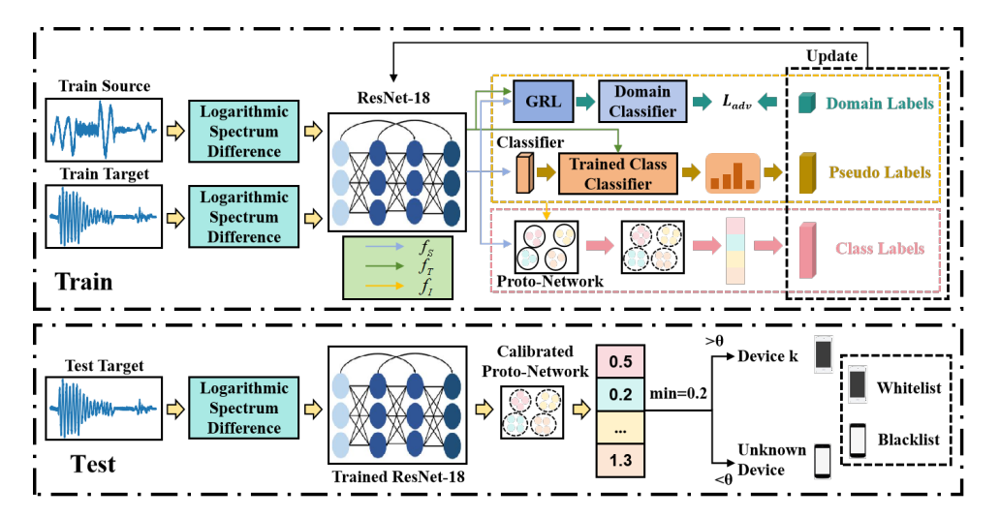
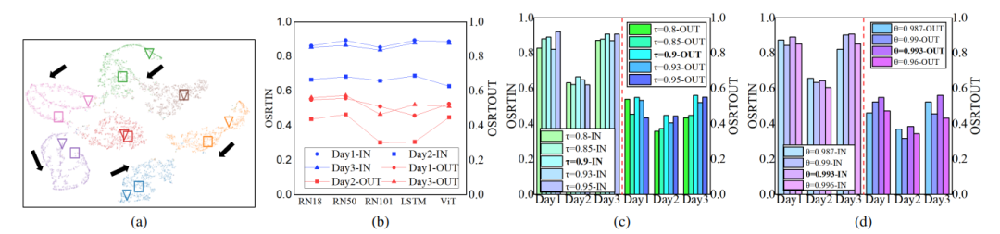
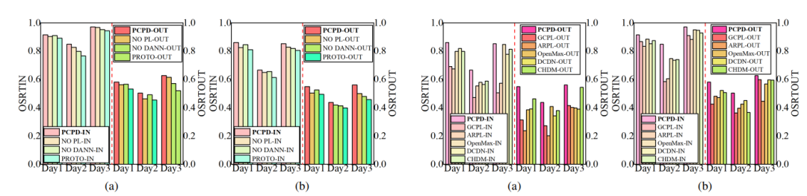

# Radiation Source Separation - Prototype Calibration Field-Adaptive Radio Frequency Fingerprint Identification [with Python code]

Abstract: As a fundamental security mechanism for wireless IoT devices, Radio Frequency Fingerprinting (RFFI) faces significant challenges in open environments and cross-domain deployments. Among existing deep learning-based Open Set Recognition (OSR) methods, the prototypical approach is widely adopted. However, due to channel effects, device load changes, etc., these methods often suffer from prototype drift and misalignment between source and target domains. To address these challenges, this paper proposes a Prototype Calibration Domain Adaptation framework (PCPD) guided by pseudo labels and Domain Adversarial Neural Networks (DANN). The framework first utilizes a prototype network to learn discriminative representations of each category in the source domain, followed by dynamic calibration of prototype points that have shifted domains through pseudo label loss and domain discriminators, enhancing cross-domain feature alignment. Based on the calibrated prototypes, this method significantly improves OSR performance in cross-domain scenarios. Experimental results show that PCPD outperforms current mainstream algorithms by approximately 10.8% in accuracy under cross-domain conditions.
Introduction: With the rapid development of wireless technology, wireless communication has become an indispensable part of modern life. Using the uniqueness of radio frequency fingerprints (RFF) for device recognition is the cornerstone of wireless communication security [1]. However, the inherent openness of wireless communication media allows malicious users to impersonate legitimate specific device identities into private networks, leading to frequent incidents of privacy leakage and property damage [3][4]. Therefore, adopting reliable RFFI technology to establish defensive mechanisms for wireless communication is of great significance for ensuring wireless communication security.
Traditional radio frequency fingerprinting methods primarily rely on manual design of features (such as the imbalanced characteristic of transmitter I/Q [5]), and extract statistical features from signal envelopes for recognition [6]. With the development of deep learning, significant breakthroughs have been made in known device classification domains, including network architectures commonly used for automatic extraction and discrimination of radio frequency fingerprints, such as CNN [7], RNN [8], and ResNet [9]. However, these methods are based on the closed-set assumption, highlighting the urgent need for open set recognition (OSR) methods.
Existing OSR methods incorporate a multi-domain feature fusion strategy that combines ResNet and TransformerEncoder to capture features [10]; meanwhile, discriminative feature learning methods like GCPL [11], ARPL [12], and JRFFP-SC [13] can construct separable feature spaces for known categories. However, when deployed in dynamic wireless environments, these methods significantly degrade performance [14]. The main reason for this decline is the inherent variability of wireless channels and domain shifts caused by device operating states [15][16], which lead to unpredictable shifts in underlying data distribution, posing a core challenge for robust open set recognition in radio frequency fingerprinting.
To address the challenges of prototype drift and cross-domain feature misalignment due to channel distortion and device load changes, this paper proposes a novel prototypical calibration framework that enhances open set discrimination capabilities through joint stabilization of prototype positioning and enhancement. Based on the inherent advantage of prototypical networks forming stable, compact clusters of hardware defects across different channels, PCPD includes three core innovations:
(1) An adaptive prototypical calibration domain framework that dynamically calibrates prototypes according to signal environment changes to improve the robustness of open set recognition;
(2) A dual-path optimization mechanism that collaborates with domain alignment and dynamic pseudo label correction to correct drifted prototypes, enhancing the generalization capability of open set recognition in radio frequency fingerprinting.
Method Introduction: PCPD is a novel OSDA method, which includes three parts: data preprocessing module, prototype-based open set identification module and prototype calibration module.
1. Preprocessing
2. Prototype-based open set recognition enhances intra-class compactness and inter-class separability by designing a prototype loss function to optimize feature discrimination capabilities. This function minimizes the distance between similar samples and the prototype, and maximizes the distance between dissimilar samples and the prototype [17]. For each known device category, a prototype vector is defined in the feature space, and preprocessed spectral features are input into ResNet-18 to extract D-dimensional embeddings. The prototype vector is generated from the feature mean of support set samples. The prototype loss function combines Euclidean distance metrics with contrastive learning mechanisms, and determines class-specific distance thresholds θ through data-driven methods, balancing the effects of known class inclusion and unknown class exclusion.
3. Prototype Calibration Based on Pseudo-Labels and DANN: To address the issue of prototype misalignment caused by channel effects, a hybrid approach combining DANN with pseudo-labeling mechanism is proposed.
•  
DANN Prototype Calibration: By employing the DANN architecture to mitigate the distribution differences between source and target domains, the feature extractor is trained in an adversarial manner through a Gradient Reverse Layer (GRL) with a domain discriminator to learn invariant feature representations and obtain adversarial loss.
•  
Pseudo-labeling Prototype Calibration: The introduction of a pseudo-labeling mechanism based on confidence, where for target domain samples, if the maximum probability output by the classifier exceeds a preset threshold τ, a pseudo label is generated. A pseudo-label cross-entropy loss is designed based on the filtered pseudo-label samples, with the ultimate goal of overall optimization combining the prototype loss, domain adversarial loss, and pseudo-label loss.
PCPD adopts a modular design that supports flexible replacement of backbone networks (such as ResNet variants, LSTM, ViT), avoiding the over-alignment problem in standard domain adaptation methods that sacrifice discriminativeness of radio frequency fingerprints for distribution matching.
Conclusion: This paper proposes a Prototype Calibration Domain Adaptation Network (PCPD) guided by pseudo labels and DANN. By integrating the prototype network, DANN, and pseudo-label mechanisms, the framework enhances the model's recognition ability and cross-domain generalization performance under open-set scenarios. In single-source and multi-source open-set recognition scenarios, the significant advantages of PCPD in multiple evaluation metrics indicate its strong performance not only in radio frequency fingerprint recognition tasks but also its outstanding cross-domain generalization capabilities, providing a new solution for open-set domain adaptation needs.
Future work will focus on developing a universal multi-classification framework and designing lightweight models suitable for edge deployment to build a mature radio frequency fingerprint recognition system, meeting the demands of real-world Internet of Things scenarios.
End

## Images

<!-- PAYMENT_BLOCK -->

## Get this dataset

- Payment link (Stripe): [Buy now](https://buy.stripe.com/3cs8yP7sY87d0vu9AB)
- Payment QR code: 

<!-- /PAYMENT_BLOCK -->
